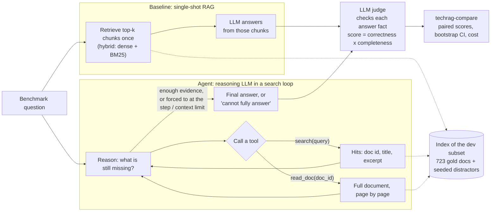

# TechRAG

A reasoning-RAG project: it tests whether a **reasoning LLM that decides for itself what to
search for and which documents to read** answers hard enterprise questions better than
single-shot retrieval. The agent is an off-the-shelf reasoning model (`qwen3.5:9b` on local
[Ollama](https://ollama.com)) in a search loop with `search` and `read_doc` tools, not a trained
model. It is prompted to plan each lookup, read whole documents instead of trusting short excerpts,
flag documents that disagree, and say so when the evidence is missing. It is measured on
[EnterpriseRAG-Bench](#reasoning-rag-on-enterpriserag-bench) (about 512k enterprise documents, 500
questions across ten types) against a single-shot RAG baseline, with an LLM judge for grading.

Underneath is a small [retrieval toolkit](#core-rag-toolkit): Markdown docs are chunked, embedded
with [`BAAI/bge-small-en-v1.5`](https://huggingface.co/BAAI/bge-small-en-v1.5), stored in FAISS and
searched densely, by BM25 or both, with a cited-answer command and an HTTP API. The sample corpus
for it is a handful of PyTorch notes in [data/quicktest/pytorch/](data/quicktest/pytorch/).

## Workflow



## Results

On a dev sample of 80 questions (8 per type, seed 0) over a 20,723-document subset (723 gold
documents plus 20,000 distractors, 280k chunks), the reasoning agent scored **0.706** against
the baseline's **0.458**: +0.248, 95% bootstrap CI +0.145 to +0.349. It costs about three times as
much per question (28.6 s and 3.9 model turns on average, against 10.1 s and a single model
call).

| Question type | Baseline | Agent | Δ |
| --- | --- | --- | --- |
| constrained | 0.286 | 0.857 | +0.571 |
| intra_document_reasoning | 0.527 | 0.969 | +0.442 |
| conflicting_info | 0.250 | 0.678 | +0.428 |
| high_level | 0.325 | 0.658 | +0.333 |
| miscellaneous | 0.646 | 0.896 | +0.250 |
| project_related | 0.412 | 0.634 | +0.221 |
| completeness | 0.241 | 0.452 | +0.211 |
| semantic | 0.125 | 0.250 | +0.125 |
| info_not_found | 1.000 | 1.000 | 0 |
| basic | 0.771 | 0.667 | −0.104 |
| **All (80)** | **0.458** | **0.706** | **+0.248** |

Scores are the judge's correctness × completeness, 0 to 1. Questions that combine or check
evidence (constraints, conflicting sources, reasoning inside a document) gain most; simple
lookups gain nothing or lose a little. Retrieval is still the bottleneck: for the 15 of 80
questions where the agent never saw some of the gold documents, it scores 0.21, against 0.82 when
it saw all of them. With 8 questions per type the per-type rows are noisy; the overall interval
is the reliable figure. It has not been run on all 500 questions.

## Setup

Requires Python 3.12+ and [uv](https://docs.astral.sh/uv/).

```sh
uv sync
```

## Reasoning RAG on EnterpriseRAG-Bench

Everything runs locally on Ollama (`qwen3.5:9b` answers, researches and judges), and the commands
share defaults, so the steps run in order with no flags. Requires the
[Setup](#setup) above, the dataset under `data/external/EnterpriseRAG-Bench` (git-ignored) and
`ollama pull qwen3.5:9b`.

### Build a dev subset and index it

The full corpus is too big for a laptop, so `techrag-subset`
writes every document that answers a question (723 of them) plus seeded random
distractors (`--distractors`, default 20,000) to `data/subsets/dev/`, laid out as `<source_type>/<doc_id>.md`, with the questions
in `questions.jsonl`:

```sh
uv run techrag-subset                                      # --distractors, --seed, --out-dir
uv run techrag-ingest data/subsets/dev --index-dir .index/dev
```

### Measure retrieval

`techrag-recall` reports document-level recall: for each question, which
of its gold documents show up in the top `k` chunks (`k` = 5, 10, 20, 50, 100), overall and per
question type. Questions with no gold documents are skipped. Takes `--mode` (default `dense`);
the report is written to `eval/recall.json`.

```sh
uv run techrag-recall --mode hybrid
```

### Grade answers

[judge.py](src/techrag/eval/judge.py) scores an answer against the question's
`answer_facts` checklist with an LLM judge. `score = correctness x completeness`: completeness is
the share of facts the answer states, and correctness drops to 0 if the answer contradicts the
reference or makes a claim a fact forbids. Because a biased judge distorts every later number,
`techrag-judge` probes it with answers whose score is known (the reference answer, a refusal,
half the facts, another question's answer) and reports how often it agrees:

```sh
uv run techrag-judge -n 20          # --seed, --model, --think; writes eval/judge_selftest.json
```

### Run the baseline and the agent

`techrag-baseline` retrieves the top `k` chunks once (hybrid by default) and answers from them.
`techrag-agent` instead gives the reasoning model two tools, `search` (finds passages, shows
document ids, titles and excerpts) and `read_doc` (reads a whole document page by page), and lets
it use them for up to `--max-steps` turns before answering. Before each call it states what it is
looking for. `--think` also turns on the model's own reasoning mode. Both grade every answer with
the judge and print scores by question type.

```sh
uv run techrag-baseline --per-type 8
uv run techrag-agent --per-type 8
```

| Option | Default | Description |
| --- | --- | --- |
| `--subset` | `data/subsets/dev` | Subset with the questions |
| `--index-dir` | `.index/dev` | Index of the subset |
| `--mode` | `hybrid` | Retrieval method |
| `--llm` | `qwen3.5:9b` | Model that answers (baseline) or researches (agent) |
| `--think` | off | Let the model reason before replying |
| `--judge-model` | `qwen3.5:9b` | Model that grades |
| `-n` / `--per-type` | all questions | Seeded sample: `n` random questions, or this many of every type. Not both |
| `--seed` | `0` | Sampling seed. Growing `--per-type` only adds questions, so saved results stay valid |
| `--output` | `eval/baseline.jsonl`, `eval/agent.jsonl` | JSON Lines results |
| `--fresh` | off | Discard earlier results first |
| `-k` | `10` | Chunks given to the model (baseline only) |
| `--max-steps` | `8` | Model turns per question (agent only) |
| `--ids` | all | Comma-separated question ids to run (agent only) |

Each question is appended to the results file as soon as it is graded, so an interrupted run
resumes where it stopped, and questions that errored are retried on the next run.

### Compare them

`techrag-compare` pairs the two result files question by question and reports
the per-type and overall score difference with a seeded bootstrap 95% confidence interval, plus
the cost (seconds, model turns and tokens per question). `--names A B` relabels the columns.

```sh
uv run techrag-compare eval/baseline.jsonl eval/agent.jsonl
```

## Core RAG toolkit

The retrieval pieces the experiment above builds on, usable on their own over any Markdown docs.

### 1. Build the index

```sh
uv run techrag-ingest [data_dir]
```

Reads every `*.md` file under `data_dir` (default `data/quicktest`), chunks it, embeds the chunks, and
writes the index to `.index/` (git-ignored). The embedding model is downloaded on first use.

| Option | Default | Description |
| --- | --- | --- |
| `--index-dir` | `.index` | Where to write the index |
| `--size` | `500` | Max characters per chunk |
| `--overlap` | `50` | Characters shared by adjacent chunks |
| `--model` | `BAAI/bge-small-en-v1.5` | sentence-transformers model |

### 2. Search

```sh
uv run techrag-retrieve "How does broadcasting work?" -k 3
```

Prints the `k` most similar chunks (default 5) with their source file and cosine similarity.
`--index-dir` and `--model` must match what was used for ingest. `--mode bm25` ranks by keyword
match (BM25) instead of embedding similarity and prints the BM25 score; chunks sharing no term
with the query are not returned. `--mode hybrid` merges the dense and BM25 rankings with
reciprocal rank fusion and prints the fused score (`sum of 1/(60 + rank)`, so it is only
comparable within one query).

### 3. Ask

```sh
ollama pull llama3.2:3b   # once
uv run techrag-ask "How does broadcasting work?"
```

Retrieves the top `k` chunks for the question, sends them to a local Ollama model, and prints
the answer followed by the numbered sources. The model is instructed to answer only from the
provided passages and cite them like `[1]` or `[2][3]`; the numbers match the source list. If
the passages don't contain the answer it should say so instead of guessing.

```
Tensors are broadcastable when ... [1]

Sources:
[1] pytorch/broadcasting.md  (score 0.812)
[2] pytorch/tensors.md  (score 0.640)
```

Requires an Ollama server running at `http://localhost:11434`. Errors such as an unreachable
server, a model that hasn't been pulled, or a missing index exit with an `error: ...` message.

| Option | Default | Description |
| --- | --- | --- |
| `-k` | `5` | Number of chunks given to the model |
| `--llm` | `llama3.2:3b` | Ollama model to answer with |
| `--ollama-url` | `http://localhost:11434` | Ollama server address |
| `--index-dir` | `.index` | Index to search |
| `--embedding-model` | `BAAI/bge-small-en-v1.5` | Must match the ingest model |
| `--mode` | `dense` | Retrieval method: `dense` (embeddings), `bm25` (keyword match) or `hybrid` (both, fused) |

### 4. Evaluate

```sh
uv run techrag-eval -k 5
uv run techrag-eval -k 5 --mode hybrid
```

Runs every question in [eval/questions.jsonl](eval/questions.jsonl) against the index and
reports:

- **hit@k**: fraction of questions whose answer appears in the top `k` chunks.
- **MRR**: mean reciprocal rank of the first relevant chunk (a miss counts as 0).

A retrieved chunk counts as relevant if it comes from the question's `source` file and
contains its `evidence` text (case and whitespace are ignored). Full per-question output,
including the retrieved chunks, is written to `eval/results.json` (git-ignored; change it
with `--output`).

`--mode` selects the retrieval method being measured: `dense` (the default), `bm25` or
`hybrid`, as in [Search](#2-search). Run once per mode to compare them; the mode used is
recorded in the results file. `--index-dir` and `--model` must match what was used for ingest.

Each line of the questions file is a JSON object:

```json
{"query": "When are two tensors 'broadcastable'?", "source": "pytorch/broadcasting.md", "evidence": "dimension sizes must either be equal, one of them is 1, or one of them does not exist"}
```

`source` is relative to the data directory.

### 5. Serve

```sh
uv run techrag-serve
```

Starts an HTTP API on `http://127.0.0.1:8000`. The index is read and the embedding model is
loaded once at startup (so it can take a few seconds to come up), not per request. A missing
or inconsistent index exits with an `error: ...` message. Interactive docs are at `/docs`.

| Option | Default | Description |
| --- | --- | --- |
| `--host` | `127.0.0.1` | Address to listen on |
| `--port` | `8000` | Port to listen on |
| `--index-dir` | `.index` | Index to serve |
| `--embedding-model` | `BAAI/bge-small-en-v1.5` | Must match the ingest model |
| `--llm` | `llama3.2:3b` | Ollama model used by `/ask` |
| `--ollama-url` | `http://localhost:11434` | Ollama server address |

| Endpoint | Description |
| --- | --- |
| `GET /healthz` | Returns `{"status": "ok", "chunks": <number of indexed chunks>}` |
| `POST /search` | Returns the top `k` chunks for a query, as in [Search](#2-search) |
| `POST /ask` | Answers a query from the top `k` chunks with Ollama, as in [Ask](#3-ask) |

`/search` and `/ask` take the same JSON body; `k` (default `5`, at least 1) and `mode` (`dense`,
`bm25` or `hybrid`; default `dense`) are optional:

```sh
curl -s localhost:8000/search -H 'Content-Type: application/json' \
  -d '{"query": "How does broadcasting work?", "k": 3, "mode": "hybrid"}'
```

```json
{"results": [{"source": "pytorch/broadcasting.md", "text": "...", "score": 0.033}]}
```

`/ask` returns the answer and the chunks it was generated from, numbered by position, so a
citation like `[2]` refers to `sources[1]`:

```json
{"answer": "Tensors are broadcastable when ... [1]", "sources": [{"source": "pytorch/broadcasting.md", "text": "...", "score": 0.812}]}
```

A blank query, a `k` below 1 or an unknown `mode` returns `422`. If Ollama is unreachable or
replies unexpectedly, `/ask` returns `502`.

## Docker

Docker is for running the API, not for development. Build the index, search, ask and
evaluate locally with `uv run ...` as above. The image runs `techrag-ingest` once at build
time and does not include `eval/`, so to pick up changes to `data/quicktest/` or the code you rebuild
the image rather than re-ingesting inside a container.

```sh
docker compose up --build
docker compose exec ollama ollama pull llama3.2:3b   # once
```

Builds the API image and the web UI image and starts them alongside an Ollama container. The
web UI is on `http://localhost:8080` (nginx serves the built React app from [web/](web/) and
forwards `/api/*` to the API), and the API is on `http://localhost:8000` (see
[Serve](#5-serve) for the endpoints). The image runs
`techrag-ingest` on [data/quicktest/](data/quicktest/) at build time, so the index and the embedding model are
baked in and the container needs no network access to the Hugging Face Hub at runtime.
Rebuild (`docker compose up --build`) after changing the docs in `data/quicktest/`.

- `/ask` needs the Ollama model to be pulled into the `ollama` service, as above. It is stored
  in the `ollama` volume, so this is only needed once. `/search` and `/healthz` work without it.
- The container listens on `0.0.0.0` and runs as a non-root user. Extra `techrag-serve`
  options (such as `--llm`) can be added under `command:` in
  [docker-compose.yml](docker-compose.yml); the existing `--ollama-url` points at the
  `ollama` service.
- The image has a healthcheck that polls `/healthz`.

To build and run the API image on its own:

```sh
docker build -t techrag .
docker run --rm -p 8000:8000 techrag --ollama-url http://host.docker.internal:11434
```

`host.docker.internal` works on Docker Desktop; on Linux add
`--add-host host.docker.internal:host-gateway`.

## Development

```sh
uv run pytest        # tests
uv run ruff check    # lint
```

## Layout

```
data/quicktest/    Small sample corpus to index (committed)
data/subsets/      Benchmark dev subset built by techrag-subset (git-ignored)
data/external/     Downloaded datasets, e.g. EnterpriseRAG-Bench (git-ignored)
eval/              Labelled questions (and generated results)
src/techrag/
  api.py             FastAPI app serving search and ask
  common/
    config.py        Shared defaults: model names, index and subset paths, Ollama URL
  core/
    ingest.py        Load, chunk, embed, and store documents
    retrieve.py      Query the index (dense, BM25 or hybrid)
    bm25.py          BM25 keyword ranking
    generate.py      Answer a question from retrieved chunks with Ollama
  benchmarks/
    bench.py         Load EnterpriseRAG-Bench, build the dev subset, sample questions
  eval/
    evaluate.py      Run the eval questions
    metrics.py       hit@k and MRR
    recall.py        Document-level retrieval recall on the benchmark questions
    judge.py         LLM judge (correctness x completeness) and its self-test
  reasoning/
    baseline.py      Single-shot RAG baseline, graded and logged
    agent.py         Agentic search loop (search / read_doc tools), graded and logged
    compare.py       Paired comparison of two result files with a bootstrap CI
tests/
.github/workflows/ CI: ruff and pytest
Dockerfile         Image with the index and embedding model baked in
docker-compose.yml Web UI and API, plus an Ollama server
```
