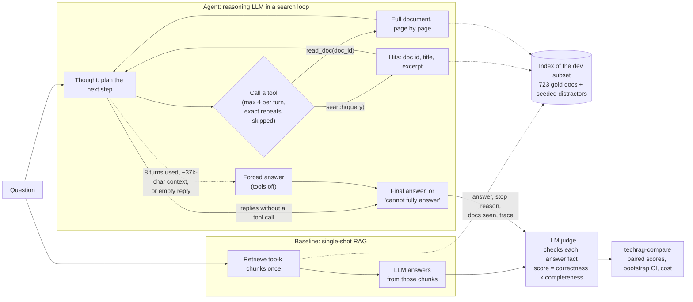

# TechRAG

A reasoning-RAG project: it tests whether a **reasoning LLM that decides for itself what to
search for and which documents to read** answers hard enterprise questions better than
single-shot retrieval. The agent is an off-the-shelf reasoning model (`qwen3.5:9b` on local
[Ollama](https://ollama.com)) in a search loop with `search` and `read_doc` tools, not a trained
model. The model decides when to search, which documents to read and when it has enough evidence;
a small [bounded loop](#how-the-agent-works) (no agent framework) only runs the tools and enforces
step, context and duplicate-call limits, then forces an answer if the budget runs out. It is
prompted to plan each lookup, read whole documents instead of trusting short excerpts, flag
documents that disagree, and say so when the evidence is missing. It is measured on
[EnterpriseRAG-Bench](#reasoning-rag-on-enterpriserag-bench) (about 512k enterprise documents, 500
questions across ten types) against a single-shot RAG baseline, with an LLM judge for grading.
[docs/enterprise-rag-bench.md](docs/enterprise-rag-bench.md) explains the dataset and each
question type.

Underneath is a small [retrieval toolkit](#core-rag-toolkit): Markdown docs are chunked, embedded
with [`BAAI/bge-small-en-v1.5`](https://huggingface.co/BAAI/bge-small-en-v1.5), stored in FAISS and
searched densely, by BM25 or both, with a cited-answer command and an HTTP API.

## Workflow



## Results

On a dev sample of 80 questions (8 per type, seed 0) over a 20,723-document subset (723 gold
documents plus 20,000 distractors, 280k chunks), the reasoning agent scored **0.706** against
the baseline's **0.454**: +0.252, 95% bootstrap CI +0.149 to +0.353. It costs about twice as
much time per question (30.6 s and 3.9 model turns on average, against 13.3 s and a single model
call), and about 14,800 tokens.

| Question type | Baseline | Agent | Δ |
| --- | --- | --- | --- |
| constrained | 0.269 | 0.857 | +0.588 |
| intra_document_reasoning | 0.527 | 0.969 | +0.442 |
| high_level | 0.325 | 0.658 | +0.333 |
| miscellaneous | 0.562 | 0.896 | +0.333 |
| project_related | 0.333 | 0.634 | +0.301 |
| conflicting_info | 0.471 | 0.678 | +0.207 |
| completeness | 0.260 | 0.452 | +0.192 |
| semantic | 0.104 | 0.250 | +0.146 |
| info_not_found | 1.000 | 1.000 | 0 |
| basic | 0.688 | 0.667 | −0.021 |
| **All (80)** | **0.454** | **0.706** | **+0.252** |

Scores are the judge's correctness × completeness, 0 to 1. Questions that combine or check
evidence (constraints, conflicting sources, reasoning inside a document) gain most; simple
lookups gain nothing or lose a little. Retrieval is still the bottleneck: for the 15 of 80
questions where the agent never saw some of the gold documents, it scores 0.21, against 0.82 when
it saw all of them. With 8 questions per type the per-type rows are noisy; the overall interval
is the reliable figure. It has not been run on all 500 questions.

## Setup

Requires Python 3.12+ and [uv](https://docs.astral.sh/uv/).

```sh
uv sync
```

## Reasoning RAG on EnterpriseRAG-Bench

Everything runs locally on Ollama (`qwen3.5:9b` answers, researches and judges), and the commands
share defaults, so the steps run in order with no flags. Requires the
[Setup](#setup) above, the dataset under `data/external/EnterpriseRAG-Bench` (git-ignored) and
`ollama pull qwen3.5:9b`.

### The questions

The 500 questions come in ten types, which differ in what makes them hard:

| Type | Count | Gold docs | Tests |
| --- | ---: | ---: | --- |
| `basic` | 175 | 1 | A direct lookup |
| `semantic` | 125 | 1 | Phrasing with little keyword overlap |
| `intra_document_reasoning` | 40 | 1 | Combining distant sections of one document |
| `project_related` | 40 | 2–9 | Aggregating several documents of a project |
| `constrained` | 30 | 1–2 | Qualifiers (date, region, customer) pick one of several similar documents |
| `conflicting_info` | 20 | 2 | Documents disagree; the answer must reconcile them |
| `completeness` | 20 | 2–10 | Needs every relevant document |
| `miscellaneous` | 20 | 1 | Informal or off-topic documents |
| `info_not_found` | 20 | 0 | The corpus has no answer; the model should say so |
| `high_level` | 10 | 0 | Broad question with no single source |

See [docs/enterprise-rag-bench.md](docs/enterprise-rag-bench.md) for examples and scoring.

### Build a dev subset and index it

The full corpus is too big for a laptop, so `techrag-subset`
writes every document that answers a question (723 of them) plus seeded random
distractors (`--distractors`, default 20,000) to `data/subsets/dev/`, laid out as `<source_type>/<doc_id>.md`, with the questions
in `questions.jsonl`:

```sh
uv run techrag-subset                                      # --distractors, --seed, --out-dir
uv run techrag-ingest data/subsets/dev
```

### Measure retrieval

`techrag-recall` reports document-level retrieval at `k` = 5, 10, 20, 50, 100 chunks, overall and
per question type, with two metrics:

- **recall** (`R@k`): the mean fraction of a question's gold documents found in the top `k` chunks.
- **complete** (`all@k`): the share of questions whose gold documents were *all* found in the top
  `k` chunks. This is stricter, and matters for questions that need several documents (e.g.
  `completeness`), since a missing document means the answer can't be complete.

Questions with no gold documents are skipped. Takes `--mode` (default `dense`); the report is
written to `eval/recall.json`.

```sh
uv run techrag-recall --mode hybrid
```

### Grade answers

[judge.py](src/techrag/eval/judge.py) scores an answer against the question's
`answer_facts` checklist with an LLM judge. `score = correctness x completeness`: completeness is
the share of facts the answer states, and correctness drops to 0 if the answer contradicts the
reference or makes a claim a fact forbids. Because a biased judge distorts every later number,
`techrag-judge` probes it with answers whose score is known (the reference answer, a refusal,
half the facts, another question's answer) and reports how often it agrees:

```sh
uv run techrag-judge -n 20          # --seed, --model, --think; writes eval/judge_selftest.json
```

### Run the baseline and the agent

`techrag-baseline` retrieves the top `k` chunks once (hybrid by default) and answers from them.
`techrag-agent` instead gives the reasoning model two tools, `search` (finds passages, shows
document ids, titles and excerpts) and `read_doc` (reads a whole document page by page), and lets
it use them for up to `--max-steps` turns before answering. Before each call it states what it is
looking for. `--think` also turns on the model's own reasoning mode. Both grade every answer with
the judge and print scores by question type.

```sh
uv run techrag-baseline --per-type 8
uv run techrag-agent --per-type 8
```

| Option | Default | Description |
| --- | --- | --- |
| `--subset` | `data/subsets/dev` | Subset with the questions |
| `--index-dir` | `.index/dev` | Index of the subset |
| `--mode` | `hybrid` | Retrieval method |
| `--llm` | `qwen3.5:9b` | Model that answers (baseline) or researches (agent) |
| `--think` | off | Let the model reason before replying |
| `--judge-model` | `qwen3.5:9b` | Model that grades |
| `-n` / `--per-type` | all questions | Seeded sample: `n` random questions, or this many of every type. Not both |
| `--seed` | `0` | Sampling seed. Growing `--per-type` only adds questions, so saved results stay valid |
| `--output` | `eval/baseline.jsonl`, `eval/agent.jsonl` | JSON Lines results |
| `--fresh` | off | Discard earlier results first |
| `-k` | `10` | Chunks given to the model (baseline only) |
| `--max-steps` | `8` | Model turns per question (agent only) |
| `--ids` | all | Comma-separated question ids to run (agent only) |

Each question is appended to the results file as soon as it is graded, so an interrupted run
resumes where it stopped, and questions that errored are retried on the next run.

#### How the agent works

[agent.py](src/techrag/reasoning/agent.py) is a bounded loop with no agent framework: the model
decides what to search for, what to read and when it has enough; Python only runs the tools and
enforces limits. The loop talks to the model through a plain `AgentChat` function, so it can be
tested or pointed at another backend without Ollama.

| Tool | Returns |
| --- | --- |
| `search(query, k=8)` | Up to `k` (1–15) documents as `[doc_id] source - title` plus a ~700-character excerpt, from hybrid chunk search grouped by document |
| `read_doc(doc_id, start=0)` | A 6,000-character page of the document, with a footer giving the next `start` if it continues |

Each turn the model either calls tools (at most 4 are run per turn) or replies in plain prose,
which is taken as the final answer. Tool results are appended to the conversation and the loop
repeats. A bad argument, unknown tool or unknown document id comes back to the model as text, so
it can correct itself instead of crashing the run. An exact repeat of an earlier call is not run;
the model is told to try a different query.

The run ends in one of four ways, recorded as `stop` in each result:

| `stop` | Meaning |
| --- | --- |
| `answered` | The model replied without calling a tool |
| `max_steps` | The step budget (`--max-steps`, default 8) ran out |
| `context` | The prompt passed about 37k characters (75% of the 16k-token window at 3 characters per token). Ollama silently drops the start of an overlong prompt, which would lose the question |
| `empty` | The model replied with neither text nor a tool call |

Any stop but `answered` triggers one last turn with tools disabled and an instruction to answer
from what was found, or to say what is missing. The result keeps the answer, turns, tokens, the
documents the model was shown and a per-call trace (the model's one-line thought, tool,
arguments, documents shown). The judge grades it the same way as the baseline, and the share of
gold documents the agent saw (`gold_found`) is recorded, which is how the finding above about
retrieval being the bottleneck was measured.

Sampling is greedy (`temperature=0`) for repeatability, and `think` is off by default because the
agent already writes a line of reasoning before each call and thinking makes every step several
times slower.

### Compare them

`techrag-compare` pairs the two result files question by question and reports
the per-type and overall score difference with a seeded bootstrap 95% confidence interval, plus
the cost (seconds, model turns and tokens per question). `--names A B` relabels the columns.

```sh
uv run techrag-compare eval/baseline.jsonl eval/agent.jsonl
```

## Core RAG toolkit

The retrieval pieces the experiment above builds on, usable on their own over any Markdown docs
(the examples below use the dev subset built above).

### 1. Build the index

```sh
uv run techrag-ingest [data_dir]
```

Reads every `*.md` file under `data_dir` (default `data/subsets/dev`), chunks it, embeds the chunks, and
writes the index to `.index/dev/` (git-ignored). The embedding model is downloaded on first use.

| Option | Default | Description |
| --- | --- | --- |
| `--index-dir` | `.index/dev` | Where to write the index |
| `--size` | `500` | Max characters per chunk |
| `--overlap` | `50` | Characters shared by adjacent chunks |
| `--model` | `BAAI/bge-small-en-v1.5` | sentence-transformers model |

### 2. Search

```sh
uv run techrag-retrieve "What is our parental leave policy?" -k 3
```

Prints the `k` most similar chunks (default 5) with their source file and cosine similarity.
`--index-dir` and `--model` must match what was used for ingest. `--mode bm25` ranks by keyword
match (BM25) instead of embedding similarity and prints the BM25 score; chunks sharing no term
with the query are not returned. `--mode hybrid` merges the dense and BM25 rankings with
reciprocal rank fusion and prints the fused score (`sum of 1/(60 + rank)`, so it is only
comparable within one query).

### 3. Ask

```sh
ollama pull llama3.2:3b   # once
uv run techrag-ask "What is our parental leave policy?"
```

Retrieves the top `k` chunks for the question, sends them to a local Ollama model, and prints
the answer followed by the numbered sources. The model is instructed to answer only from the
provided passages and cite them like `[1]` or `[2][3]`; the numbers match the source list. If
the passages don't contain the answer it should say so instead of guessing.

```
Parental leave is ... [1]

Sources:
[1] hr/doc_123.md  (score 0.812)
[2] hr/doc_456.md  (score 0.640)
```

Requires an Ollama server running at `http://localhost:11434`. Errors such as an unreachable
server, a model that hasn't been pulled, or a missing index exit with an `error: ...` message.

| Option | Default | Description |
| --- | --- | --- |
| `-k` | `5` | Number of chunks given to the model |
| `--llm` | `llama3.2:3b` | Ollama model to answer with |
| `--ollama-url` | `http://localhost:11434` | Ollama server address |
| `--index-dir` | `.index/dev` | Index to search |
| `--embedding-model` | `BAAI/bge-small-en-v1.5` | Must match the ingest model |
| `--mode` | `dense` | Retrieval method: `dense` (embeddings), `bm25` (keyword match) or `hybrid` (both, fused) |

### 4. Serve

```sh
uv run techrag-serve
```

Starts an HTTP API on `http://127.0.0.1:8000`. The index is read and the embedding model is
loaded once at startup (so it can take a few seconds to come up), not per request. A missing
or inconsistent index exits with an `error: ...` message. Interactive docs are at `/docs`.

| Option | Default | Description |
| --- | --- | --- |
| `--host` | `127.0.0.1` | Address to listen on |
| `--port` | `8000` | Port to listen on |
| `--index-dir` | `.index/dev` | Index to serve |
| `--embedding-model` | `BAAI/bge-small-en-v1.5` | Must match the ingest model |
| `--llm` | `llama3.2:3b` | Ollama model used by `/ask` |
| `--ollama-url` | `http://localhost:11434` | Ollama server address |

| Endpoint | Description |
| --- | --- |
| `GET /healthz` | Returns `{"status": "ok", "chunks": <number of indexed chunks>}` |
| `POST /search` | Returns the top `k` chunks for a query, as in [Search](#2-search) |
| `POST /ask` | Answers a query from the top `k` chunks with Ollama, as in [Ask](#3-ask) |

`/search` and `/ask` take the same JSON body; `k` (default `5`, at least 1) and `mode` (`dense`,
`bm25` or `hybrid`; default `dense`) are optional:

```sh
curl -s localhost:8000/search -H 'Content-Type: application/json' \
  -d '{"query": "What is our parental leave policy?", "k": 3, "mode": "hybrid"}'
```

```json
{"results": [{"source": "hr/doc_123.md", "text": "...", "score": 0.033}]}
```

`/ask` returns the answer and the chunks it was generated from, numbered by position, so a
citation like `[2]` refers to `sources[1]`:

```json
{"answer": "Parental leave is ... [1]", "sources": [{"source": "hr/doc_123.md", "text": "...", "score": 0.812}]}
```

A blank query, a `k` below 1 or an unknown `mode` returns `422`. If Ollama is unreachable or
replies unexpectedly, `/ask` returns `502`.

## Docker

Docker is for running the API, not for development. Build the index, search, ask and
evaluate locally with `uv run ...` as above. The image runs `techrag-ingest` once at build
time and does not include `eval/`, so to pick up changes to `data/quicktest/` or the code you rebuild
the image rather than re-ingesting inside a container.

```sh
docker compose up --build
docker compose exec ollama ollama pull llama3.2:3b   # once
```

Builds the API image and the web UI image and starts them alongside an Ollama container. The
web UI is on `http://localhost:8080` (nginx serves the built React app from [web/](web/) and
forwards `/api/*` to the API), and the API is on `http://localhost:8000` (see
[Serve](#4-serve) for the endpoints). The image runs
`techrag-ingest` on [data/quicktest/](data/quicktest/) at build time, so the index and the embedding model are
baked in and the container needs no network access to the Hugging Face Hub at runtime.
Rebuild (`docker compose up --build`) after changing the docs in `data/quicktest/`.

- `/ask` needs the Ollama model to be pulled into the `ollama` service, as above. It is stored
  in the `ollama` volume, so this is only needed once. `/search` and `/healthz` work without it.
- The container listens on `0.0.0.0` and runs as a non-root user. Extra `techrag-serve`
  options (such as `--llm`) can be added under `command:` in
  [docker-compose.yml](docker-compose.yml); the existing `--ollama-url` points at the
  `ollama` service.
- The image has a healthcheck that polls `/healthz`.

To build and run the API image on its own:

```sh
docker build -t techrag .
docker run --rm -p 8000:8000 techrag --ollama-url http://host.docker.internal:11434
```

`host.docker.internal` works on Docker Desktop; on Linux add
`--add-host host.docker.internal:host-gateway`.

## Development

```sh
uv run pytest        # tests
uv run ruff check    # lint
```

## Layout

```
data/subsets/      Benchmark dev subset built by techrag-subset (git-ignored)
data/external/     Downloaded datasets, e.g. EnterpriseRAG-Bench (git-ignored)
docs/              Notes on the EnterpriseRAG-Bench data and question types
eval/              Generated results and reports
src/techrag/
  api.py             FastAPI app serving search and ask
  common/
    config.py        Shared defaults: model names, index and subset paths, Ollama URL
    ollama.py        Minimal Ollama chat client
  core/
    ingest.py        Load, chunk, and store documents
    embed.py         Load the embedding model and embed texts
    retrieve.py      Query the index (dense, BM25 or hybrid)
    bm25.py          BM25 keyword ranking
    generate.py      Answer a question from retrieved chunks with Ollama
  benchmarks/
    bench.py         Load EnterpriseRAG-Bench, build the dev subset, sample questions
  eval/
    recall.py        Document-level retrieval recall on the benchmark questions
    judge.py         LLM judge (correctness x completeness) and its self-test
  reasoning/
    harness.py       Shared run, grade, log and report machinery
    baseline.py      Single-shot RAG baseline, graded and logged
    agent.py         Agentic search loop (search / read_doc tools), graded and logged
    compare.py       Paired comparison of two result files with a bootstrap CI
tests/
.github/workflows/ CI: ruff and pytest
Dockerfile         Image with the index and embedding model baked in
docker-compose.yml Web UI and API, plus an Ollama server
```
